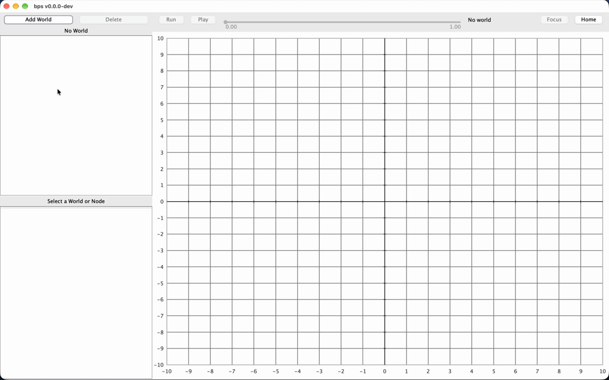

	<h1>bps</h1>
	<picture>
		
	</picture>
	<h3>A basic physics simulator written in Java.</h3>

> [!NOTE]
> TermOS is currently in alpha. Some features may not be complete! Check out the change log [here.](./CHANGELOG.md)

## Quick Start
Using JAR (Recommended):
	1. Download your favorite JRE (Java Runtime Environment) or JDK (Java Development Kit); I recommend the [official builds](https://jdk.java.net/) or through a package manager like [brew](https://formulae.brew.sh/formula/openjdk).
	2. Download the latest `.jar` file from [Releases](https://github.com/bhlcusd/bps/releases/latest).
	3. Open up the terminal and navigate to where the `.jar` is located.
	4. Execute: `java -jar bps-[version].jar`. Replace `[version]` with the file's version.
	5. Enjoy bps!

Using OS installer (not tested by developer):
	1. Download the latest installer for your OS from [Releases](https://github.com/bhlcusd/bps/releases/latest).
	2. Open the installer and follow the instructions shown.
	3. Launch and enjoy bps!

## Features

## Technicals

## Acknowledgements

## License
bps is licensed under the [GNU General Public License Version 3](./LICENSE).